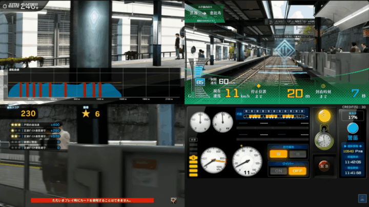
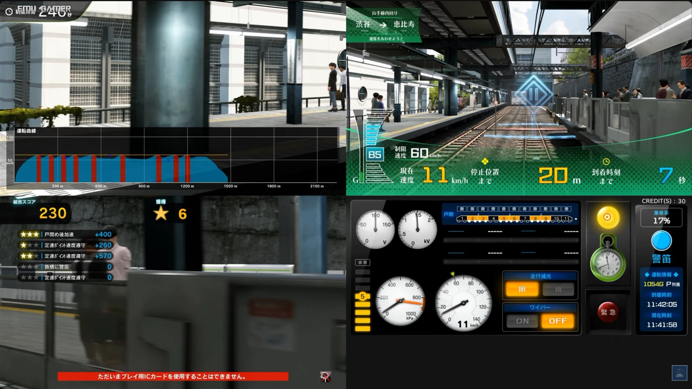
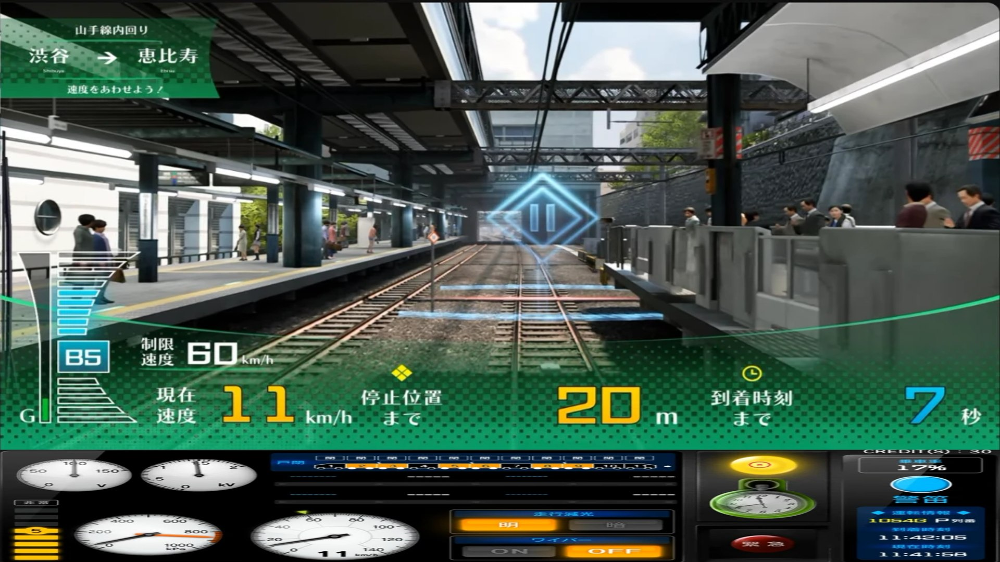
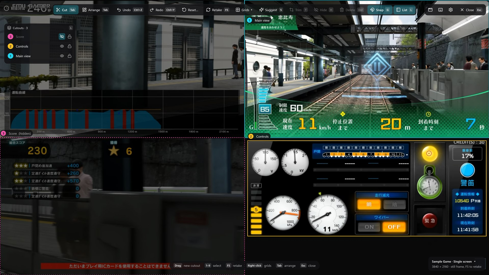
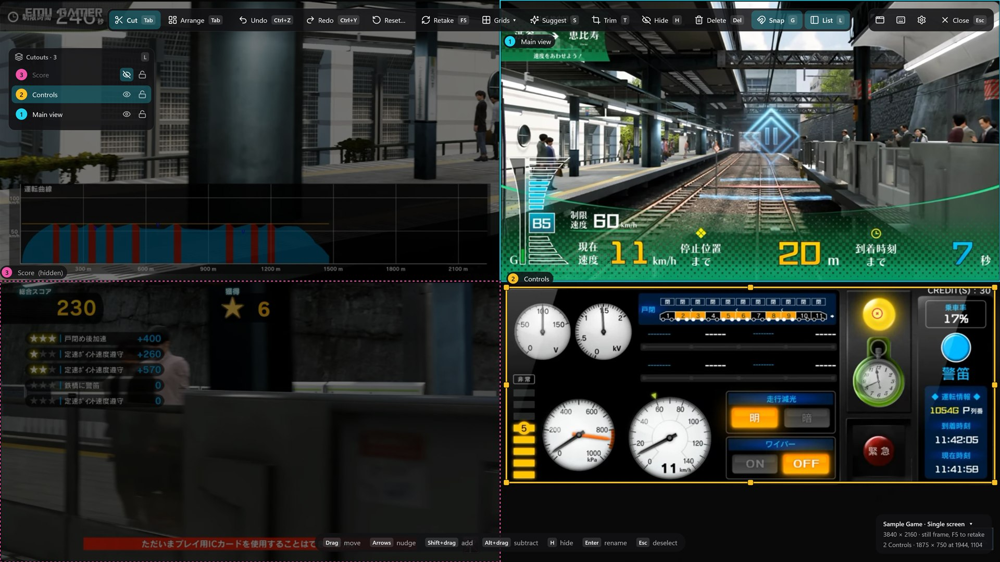
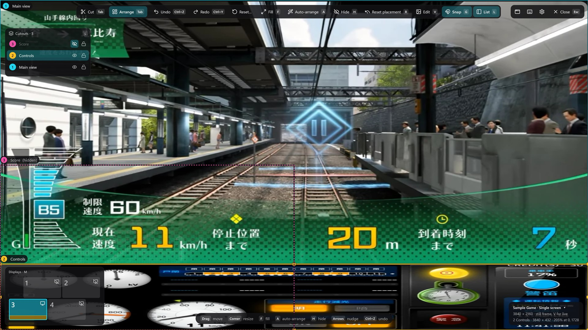
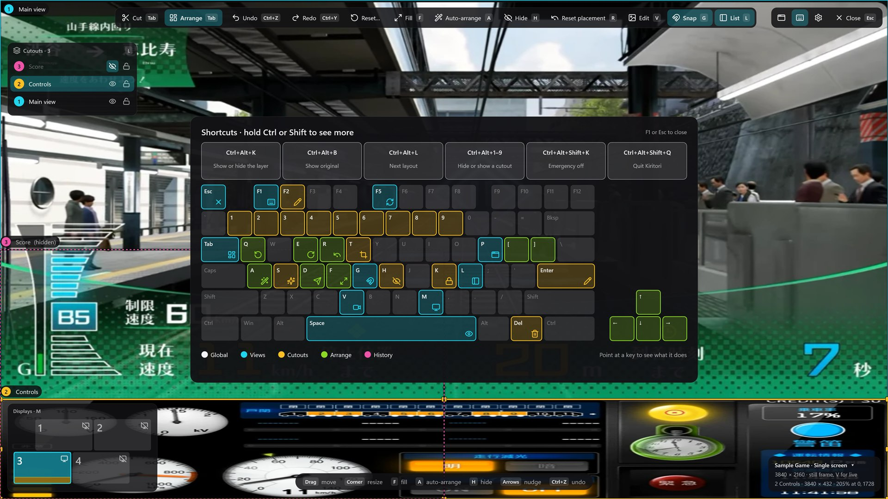
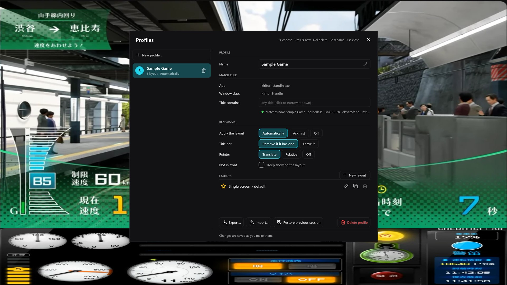
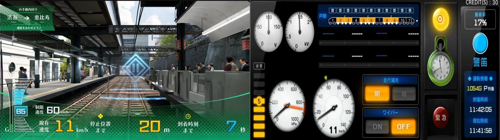
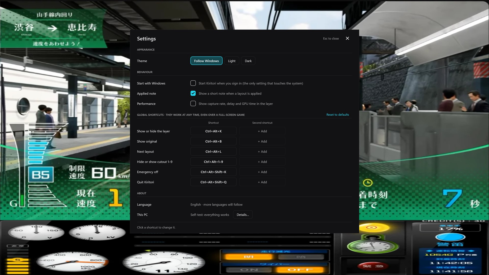

# Kiritori

**Cut, move and reshape regions of any screen.**

Kiritori (切り取り, "cut out") is a small Windows 11 tray utility. It captures one app's window, lets you cut out the parts you care about, and shows only those parts — moved, resized, hidden or spread over several displays. The app keeps running untouched underneath, and clicks on a moved part still land in the right place.

It was made for apps and games that draw several screens into one picture, like the example below: a driver's view, an instrument panel, a score sheet and a speed graph squeezed into the four quarters of one window.



*The first-run tutorial, start to finish: cut two parts, hide one, arrange, stretch them to fill the screen edge to edge, peek, close. About a minute.*

| Before | After |
|---|---|
|  |  |

---

## Contents

- [What it does](#what-it-does)
- [Quick start](#quick-start)
- [How to use it](#how-to-use-it)
- [Keyboard shortcuts](#keyboard-shortcuts)
- [Profiles and layouts](#profiles-and-layouts)
- [Several displays](#several-displays)
- [Settings](#settings)
- [Command line](#command-line)
- [Good to know](#good-to-know)
- [Building from source](#building-from-source)
- [Licence and credits](#licence-and-credits)

## What it does

- **Cut** any number of named regions out of an app's window, with snapping to halves and thirds, ready-made grids, and **Suggest** (S), which finds the panels in the picture for you.
- **Arrange** them on the screen: move, resize (corners keep the shape, edges stretch width or height alone), fill the display (F), auto-arrange (A), rotate (Q / E), mirror, hide (H), lock (K).
- **Spread them over several displays**: each display is *Takeover* (black, only your cutouts) or *Float* (cutouts over the normal desktop).
- **Keep pointing where you mean**: clicks and taps on a moved cutout reach the app at the original spot, and Kiritori draws the app's own cursor there. Touch works one finger at a time; if taps on a touchscreen land on the wrong display, tell Windows which display it is (Control Panel → Tablet PC Settings → Setup).
- **Upscale cleanly**: *Enhanced* scaling (AMD FidelityFX FSR 1) for enlarged parts, *Sharp* for pixel art and crisp panels, on any Direct3D 11 graphics card.
- **Remember everything per app**: a profile per game, several layouts each, applied automatically the moment the game appears (within a fraction of a second).
- **Stay out of the way**: one tray icon, five global shortcuts, nothing drawn but your cutouts. *Show original* (Ctrl+Alt+B) and *Emergency off* (Ctrl+Alt+Shift+K) are always one keypress away.
- **Portable**: one folder, no installer. Copy it to another PC or a USB stick and every profile comes along.

## Quick start

1. **Download** `Kiritori-0.1.3-windows-x64.zip` from [Releases](../../releases) and unzip it anywhere you can write to (not *Program Files*). Or [build it](#building-from-source).
2. **Run** `kiritori.exe`. A tray icon appears; nothing else changes.
3. **Start your game** (windowed or borderless; see [Good to know](#good-to-know)).
4. **Press `Ctrl+Alt+K`.** The Kiritori layer opens over the game on a still frame, and a short tutorial card guides you through the rest:
   - **Drag** across a part you want to keep, type a name, press **Enter**. Repeat.
   - Press **H** on a part you don't want.
   - Press **Tab** for Arrange view, then **A** to auto-arrange (or drag, resize and press **F** to fill).
   - Hold **Space** to peek at the result, then **Esc** to close.
5. **That's it.** The next time the game starts, Kiritori applies the layout by itself and shows a short note: `Kiritori · Single screen · Ctrl+Alt+K to edit`.

> Lost? `Ctrl+Alt+B` shows the original picture, `Ctrl+Alt+Shift+K` switches everything off, and `Ctrl+Alt+Shift+Q` quits Kiritori.

## How to use it

### Cut view: choose the parts

The layer opens on a still frame of the app. Everything you have not cut is dimmed.



- **Drag** on the picture to cut a new part. Edges snap to the picture's halves and thirds and to other cutouts (hold **Ctrl** to stop snapping; **G** turns it off).
- **Shift+drag** adds a rectangle to the selected cutout, **Alt+drag** subtracts one, for L-shaped or holed parts.
- **S** suggests cutouts from the picture's panels; **T** trims black edges from the selected one.
- **1–9** select, **Enter** or **F2** rename, **Delete** deletes, **arrows** move the cut by a pixel (Shift: 10).
- Every name box (cutouts, layouts, profiles, the title rule) edits like any text box: arrows, **Home**/**End** and **Ctrl+arrows** move the caret, **Shift** selects (or drag with the mouse; double-click selects a word), **Ctrl+A/C/X/V** select all, copy, cut and paste, **Ctrl+Z/Y** undo and redo. **Enter** keeps the name, **Esc** cancels.
- **F5** takes a new still frame. Right-click for the menu, including ready-made grids (halves, thirds, quadrants).



### Arrange view: place them

**Tab** switches to Arrange, which shows the screen exactly as it will look.



- **Drag** to move. Drag a **corner** handle to resize keeping the shape (sizes snap to 100%, 150% and 200%), or a handle in the **middle of a side** to stretch just the width or just the height, so a cutout can fill any area. **Shift** swaps the two. Edges snap to the display and to each other.
- **Alt+arrows** stretch from the keyboard (Left/Right for the width, Up/Down for the height; with **Shift**, 10 px at a time). **Ctrl+arrows** resize keeping the shape.
- **F** fills the display (again to restore), **A** auto-arranges around the selected cutout (again to try the other side), **R** resets it to its original place.
- **Q / E** rotate a quarter turn, **[ / ]** send backward or bring forward, **K** locks, **H** hides.
- **V** switches between the still frame and the moving picture. Hold **Space** to peek without any controls.
- **Ctrl+Z / Ctrl+Y** undo and redo everything; hold the Undo button for the full history. Hold **Ctrl+Shift+Backspace** to reset the arrangement or start over.

Every button in the toolbar shows its shortcut, and **F1** (or **?**) opens the full shortcut map:



**Esc** closes the layer. Everything is saved as you go.

## Keyboard shortcuts

**Global** — work at any time, even over a full-screen game. All can be changed in Settings, and each can have a second shortcut.

| Shortcut | Action |
|---|---|
| `Ctrl+Alt+K` | Show or hide the Kiritori layer |
| `Ctrl+Alt+B` | Show original (on/off) |
| `Ctrl+Alt+L` | This app's next layout |
| `Ctrl+Alt+1` … `9` | Hide or show cutout 1–9 without opening the layer |
| `Ctrl+Alt+Shift+K` | Emergency off: close the layer, remove everything, stop capturing |
| `Ctrl+Alt+Shift+Q` | Quit Kiritori |

**In the layer** — single keys, so they never reach the game.

| Key | Cut view | Arrange view |
|---|---|---|
| `Tab` | Arrange | Cut |
| `Esc` | Cancel, deselect, close | Cancel, deselect, close |
| `1`–`9` | Select a cutout | Select a cutout |
| `Enter` / `F2` | Rename | Rename |
| `H` / `K` / `Delete` | Hide / lock / delete | Hide / lock / delete |
| `S` / `T` | Suggest cutouts / trim black | — |
| `F` / `A` / `R` | — | Fill / auto-arrange / reset placement |
| `Q` / `E` | — | Rotate left / right |
| `D` / `Ctrl+D` | — / duplicate | Send to next display / duplicate |
| `M` | — | Display map |
| `V` | — | Still frame / live picture |
| `G` | Snapping | Snapping |
| `L` / `P` / `F1` | Cutout list / Profiles / Shortcut map | Cutout list / Profiles / Shortcut map |
| `Ctrl+,` | Settings | Settings |
| hold `Space` | Peek | Peek |
| `Ctrl+Z` / `Ctrl+Y` | Undo / redo | Undo / redo |

## Profiles and layouts

Kiritori recognises an app by its executable, window class and (optionally) part of its title, and applies that app's layout whenever its window comes to the front. For games that share one generic executable (Unreal Engine's `*-Win64-Shipping.exe`, emulators, game loaders), the folder is part of the match.

Open the **Profiles** panel with **P** in the layer, from the tray, or with `kiritori --profiles`:



- **New profile…** (top of the list, or `Ctrl+N`) lists your open windows; pick one to make its profile. `Ctrl+Alt+K` over an app does the same and opens the layer on it.
- **Delete** a profile with the trash button on its row, the **Delete profile** button, or the `Del` key: the first press asks, the second deletes. A copy is kept in the `backups` folder, so **Import…** brings it back.
- **Apply the layout:** *Automatically* (default), *Ask first* (a small note with an Apply button; `Ctrl+Alt+K` also says yes), or *Off*.
- **Title bar:** Kiritori removes a windowed game's title bar and frame for a clean picture, and puts them back when it quits — even after a crash.
- **Pointer:** *Translate* (clicks on cutouts reach the app), *Relative* (for games that read raw mouse movement), or *Off* (cutouts are display-only).
- **Layouts:** several per profile — star the default, rename, duplicate, delete, or add one. `Ctrl+Alt+L` cycles through them.
- **Export / Import** a profile as one `.json` file to share it. **Restore previous session** undoes everything since Kiritori last started.

## Several displays

Any cutout can go on any connected display. In Arrange view, the **display map** (bottom left, **M**) shows your displays as Windows arranges them.



- **D** sends the selected cutout to the next display; dragging it past the edge of the screen or dropping its list row on the map does the same.
- Click a display in the map (or the card on a display that is not in use) to choose **Takeover**, **Float** or **Not in use**.
- Displays are recognised by their hardware, not their number, so Windows renumbering them changes nothing. If one is unplugged, its cutouts are *parked* and come back when it returns (`Display "Dell U2720Q" not connected · 1 cutout parked`).
- Each set of connected displays remembers its own layout: unplug the touchscreen and the game opens in *Single screen*; plug it in and it opens in *Two screens*.

## Settings

**Ctrl+,** in the layer, or *Settings…* in the tray:



- **Theme:** follows Windows' light or dark mode, or set either.
- **Start with Windows** — the only setting that touches the system (a startup entry, removed when you turn it off).
- **Performance readout:** capture rate, output rate per display, added delay and GPU time, in the layer's readout.
- **Global shortcuts:** click one and press the new combination. Kiritori warns when a combination is taken by another program, or when `Ctrl+Alt+key` types a character on your keyboard layout (AltGr).
- **This PC:** the self-test Kiritori runs at every start — folder, Windows version, capture, graphics card, Enhanced scaling, shortcuts.

## Command line

For game launchers and frontends. A second launch hands its arguments to the running copy; if none is running, Kiritori starts and acts on them.

```text
kiritori                                   start (or open the running copy's tray menu)
kiritori --launch <game.exe> [--layout <name>] [-- <game arguments>]
kiritori --apply <profile> [--layout <name>]
kiritori --bypass [on|off]
kiritori --edit | --pick | --profiles | --settings
kiritori --import <file> | --export <profile> <file>
kiritori --quit
kiritori --help                            show this list
```

`--launch` starts the game with its profile's layout ready; `--apply` and `--launch` use the layout even when the profile is set to *Ask first* or *Off*.

## Good to know

- **Windowed or borderless, not exclusive full screen.** Kiritori captures a window. Set the game to windowed or borderless; Kiritori removes the title bar for you.
- **Games that run as administrator:** Kiritori can show them, but Windows only lets it send clicks to them when it runs as administrator too. It says so and offers **Restart as administrator**.
- **Render larger for sharper cutouts.** A borderless game window can be larger than the display (for example 3840×2160 on a 1920×1080 screen); Kiritori captures all of it.
- **Recording and streaming tools** (OBS and others) see Kiritori's output like any other window.
- **The folder must be writable** for Kiritori to save; otherwise it runs, says *Not saving*, and keeps changes in memory.
- **Logs** are in `logs\` next to `kiritori.exe`, with the self-test in `logs\self-test.txt`.

## Building from source

Windows 11, [Rust](https://rustup.rs) (the MSVC toolchain is pinned in `rust-toolchain.toml`) and the Visual Studio C++ build tools with a Windows SDK (its resource compiler embeds the app icon).

```bash
cargo build --release -p kiritori
```

The program is `target\release\kiritori.exe`; copy it into a folder of its own. `cargo test --workspace` runs the unit tests (142, including the shaders on Direct3D's software renderer).

The workspace also holds `tools/standin` (a stand-in "game" that draws a picture and logs clicks, for testing without a real one), `tools/gifmaker` (builds the animation above) and `tools/latency` (measures the delay from the app drawing a frame to Kiritori showing it). Setting `KIRITORI_NO_FOCUS=1` makes Kiritori never take the keyboard focus, so scripted tests can drive it with window messages.

## Licence and credits

MIT — see [LICENSE](LICENSE).

- Icons: [Lucide](https://lucide.dev) (ISC) — [licence](licenses/lucide-ISC.txt)
- Enhanced scaling: [AMD FidelityFX Super Resolution 1](https://github.com/GPUOpen-Effects/FidelityFX-FSR) (MIT) — [licence](licenses/amd-fidelityfx-fsr1-MIT.txt)
